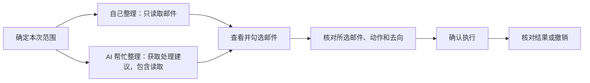
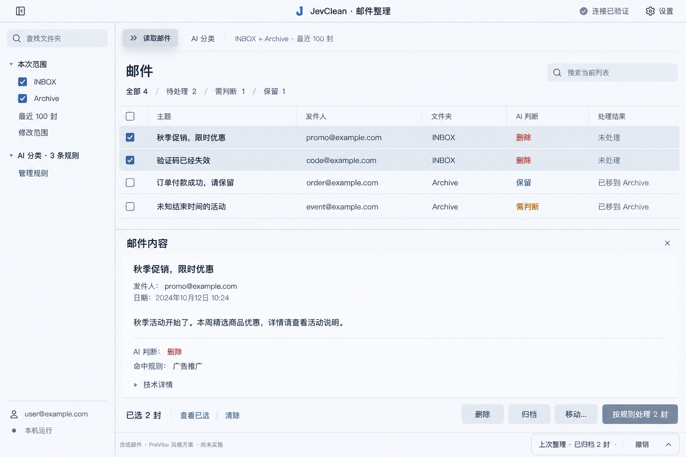
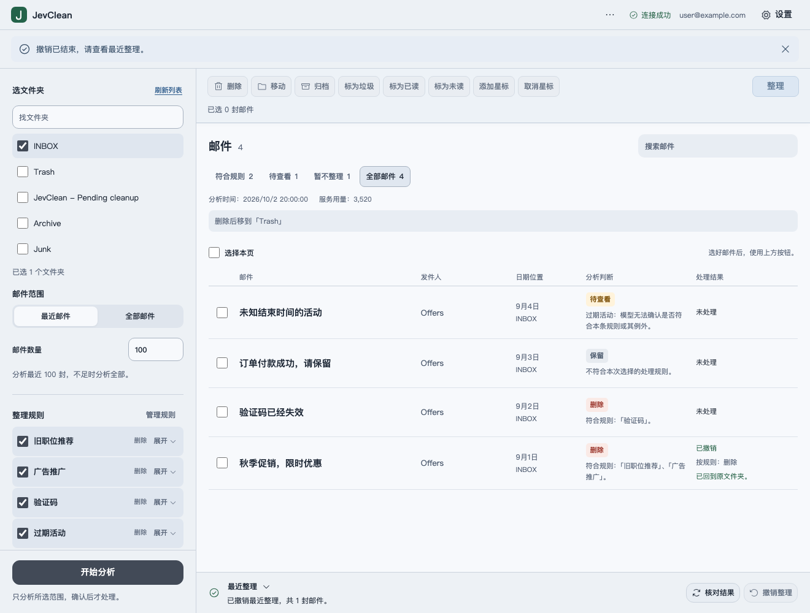

# JevClean 产品架构与视觉升级方案

初始评审日期：2026-10-06。用户已确认 PreVibe 方向并授权落地；随后在 2026-10-07 明确指定 AI 优先固定工作区。最新实现与验证状态见第12节末尾的「AI 优先工作区」，本文件不代表已经对外发布。

阅读说明：第1–11节与第12节早期小节保留历史评审及逐轮实施语境。其中首次只读十封、双入口、可折叠侧栏与规则、旧筛选名及位置测量均已由最后一轮替代。当前操作说明以 README、使用说明和最新实施小节为准，旧测试结果只证明各自当时的版本。

本次目标已确认：服务个人定期批量整理邮箱，让用户先读懂，再放心执行。用户随后明确要求 UI 模仿 PreVibe 桌面客户端；下述视觉方案以评审时该客户端的默认样式为准。此前独立风格探索不再作为候选。

**结论：保留本地处理与安全执行底座，重新组织一次整理的任务流程，重做整个界面的层级和视觉系统。先修复邮件身份同步缺陷，再做界面升级。** 当前问题不能简单归结为开发者经验不足：安全机制和隔离测试已经有实质投入；薄弱处主要在演进后的数据关系、用户认知模型和状态呈现。

## 1 用户真正需要完成什么

用户不是为了配置 IMAP、编写规则或观察模型概率而来。一次整理的价值是：用可接受的时间，找到可以处理的邮件，清楚知道处理后去哪里，并保留核对和恢复的能力。

因此产品定位为“有依据、可确认、可撤销的邮件批量整理工具”。以下为中间轮次采用、现已被 AI 优先流程替代的双路径：



衡量升级是否成功，需要看用户是否能回答五个问题：现在看到哪一批邮件；AI 为什么这样判断；自己选了哪些；确认后具体发生什么；发生异常后如何继续。界面漂亮但这五件事仍要靠读说明书，升级就没有完成。

不把“清理数量最大化”作为目标，也不承诺邮箱清空。合理保留、主动跳过和发现不确定性，同样是成功结果。

## 2 当前值得保留的资产

| 资产 | 为什么保留 | 当前依据 |
| --- | --- | --- |
| React＋本地回环 HTTP＋IMAP/Jev | 部署和运行模型符合个人工具，无需新增项目云端、项目账号或凭据代理 | `docs/architecture.md`；`src/local/server.ts` |
| 只读取邮件也可手动处理 | 用户不必先配置 AI，AI 不能否决用户的明确手动意图 | `src/core/service.ts:249`；`src/renderer/ManualPanel.tsx:20` |
| 自然语言条件，每条规则一个动作 | 面向非程序员；避免成长为复杂筛选 DSL 和工作流编辑器 | `src/shared/contracts.ts`；`src/core/classifier.ts` |
| AI 判断、执行资格、实际操作分离 | 缺少垃圾箱不是“AI 不确定”，手动移动也不意味着 AI 原判断变化 | `src/shared/contracts.ts:97`；`src/shared/contracts.ts:105` |
| 先检查、再确认、意图先保存 | 能在执行前发现配置问题，并为中断后的核对提供依据 | `src/core/service.ts:410`；`src/core/service.ts:610` |
| UIDVALIDITY、指纹、移动回执与只读核对 | 减少对错误对象操作及盲重试的风险；现有缺陷应精确修复，不推翻机制 | `src/core/service.ts:590`；`src/core/mailbox.ts:111` |
| 系统凭据库、本地加密、失败不降级 | 隐私承诺来自实现边界，不只是界面文案 | `src/core/storage.ts`；`src/local/cipher.ts` |
| 不执行邮件 HTML，不下载附件/远程图片 | 既减小风险，也符合“整理工具”的功能范围 | `src/core/mailbox.ts`；`docs/privacy.md` |
| 合成邮件、可注入服务、协议/HTTP/UI 测试 | 是重构时可以利用的工程资产；真实模型和服务商验收仍需独立完成 | `tests/fixture.ts`；`tests/ui/server.ts`；`README.md` |

本次没有理由迁移到 Electron、另起后端、引入云数据库或替换整个 IMAP 层。外观和用户流程的变化可以很大，技术迁移应由实际问题驱动。

## 3 先修复一个真实的对象身份缺陷

**实施优先级：P0，作为上线前阻断项。** 按通用缺陷严重度，它是依赖特定副本和撤销序列的高优先级问题，不是每次操作都会发生。

跨报告同步在 `src/core/service.ts:213–220` 只按邮件头元数据指纹找到操作记录，再把 UID、文件夹和状态覆盖到当前列表。该指纹包含 Message-ID、收件时间、主题、发件人地址，不包含正文，见 `src/core/privacy.ts:6`。两封物理邮件可能共用指纹，指纹不能充当唯一身份。

本轮通过仓库隔离 fixture 复现：

1. 把 INBOX 的 UID42 移到 Trash，得到 UID101。
2. INBOX 新增相同指纹的副本 UID43。
3. 重新读取 INBOX 和 Trash；列表此时包含 UID43 和 UID101。
4. 撤销后，模拟邮箱实际保留 UID43，并恢复出 UID142；列表却把两行都改成 UID142。
5. 选择原 UID43 对应的列表行，手动标记已读，实际改变的是 UID142，UID43 没有改变。

这破坏了“选中谁，就处理谁”的根本承诺。修复应围绕 `账号 + 文件夹 + UIDVALIDITY + UID` 的确切物理身份和操作前后映射；指纹继续用于一致性校验及受约束的恢复查找。需要增加同指纹副本、跨文件夹副本、重新读取后撤销及随后手动操作的回归用例。

## 4 产品架构的主要问题

### 4.1 能力已经解耦，界面还停留在 AI 分析工具阶段

只读读取和手动处理已经不依赖 Jev，界面却仍把“读取邮件”放在文件夹、数量、规则、发送同意和 AI 额度说明之后。结果区又依次铺开多种筛选、分析说明、上次整理、配置检查、两套工具栏和确认面板。

当前实现：`src/renderer/App.tsx:397–423`、`428–456`。

本轮重新构建并在独立模拟服务中打开当前代码，测量同一个分类结果状态。以下为页面顶部到元素的 CSS 像素距离，窗口高度均为 900px；不是所有状态的固定值：

| 窗口宽度 | 首封邮件顶部 | 读取/分类按钮组顶部 | 横向溢出 |
| --- | ---: | ---: | --- |
| 1440px | 656px | 950px | 无 |
| 1280px | 656px | 1229px | 无 |
| 1024px | 1525px | 909px | 无 |
| 390px | 1708px | 1136px | 无 |

“无横向溢出”不等于任务体验合格。尤其 1024px 的普通窄窗口，也要经过很长的配置区才能到邮件列表。应改变内容顺序和展开规则，而非继续缩小字号。

### 4.2 状态在数据层分开，在视觉层又混在一起

`src/renderer/MailList.tsx:9–11` 会把 moved/restored 邮件的 AI 判断徽标统一改成完成色。截图中的“需要确认”因此在手动移动后变绿。数据中的 AI 证据仍然正确，视觉却可能让人误解为判断获得了确认。

筛选也混合了不同轴：“待处理”考虑执行状态，“保留”“需要确认”主要描述 AI 判断。执行完成后仍出现在 AI 不确定集合有其合理性，但不能把这组集合说成一条互斥处理队列。

建议保留四条独立事实：

| 状态轴 | 回答的问题 | 主界面呈现 |
| --- | --- | --- |
| 邮件身份与位置 | 这是哪封，当前在哪里 | 文件夹与只读核对状态 |
| AI 判断 | 规则认为它是什么 | 未分类、具体动作、保留、需判断 |
| 执行准备 | 现在能不能执行该动作 | 就绪、需配置、已是目标状态、依据过期 |
| 实际操作 | 用户确认后发生了什么 | 未处理、处理中、已完成、待核对、已撤销 |

正常列表优先显示主题、简短判断和实际处理状态；技术概率和全部规则证据进入详情。颜色只属于它所表达的那个状态，不随另一个状态轴改写。

### 4.3 选择可以跨筛选保留，核对却不完整

当前有“选择中包含其他列表里的邮件”的提示，但确认区域主要展示动作/目标汇总，没有可检查的所选主题清单。相关位置：`App.tsx:438–452`、`ManualPanel.tsx:20–21`。

保留跨筛选选择，增加固定选择条：`已选 N · 当前列表 M · 其他筛选 K`，提供“查看已选”“清除”。确认显示实际执行集合、跳过数量及原因、目标文件夹和撤销边界。不能让用户把“当前看到的三封”误认为“全部被执行的三封”。

### 4.4 读取、分类、选中不是同一范围概念

读取和 AI 分类各自重新获取当前配置的邮件范围，见 `service.ts:261`、`318`。勾选邮件目前限制的是处理对象，不限制 AI 分类对象。

近期方案应明确显示“分类本次范围”，并显示列表快照时间；不在视觉改版里默默改成“只分类选中邮件”。若要支持后者，作为独立功能设计和验收。

### 4.5 付费分析和长任务不够可预期

隔离验证确认：邮件、规则和范围未变，连续两次 scan 仍下载正文并调用模型两次；`readMail` 的判断复用没有扩展到 `scan`。当前 `apiCalls` 只在成功响应后累计，失败请求和底层重试不计入；因此它不是实际请求尝试数，更不是精确账单。

此外，最近 N 封也先搜索全部 UID，并获取全部收件时间再排序；模型逐封执行。现有小样本或 1500 条界面布局测试不能证明十万封邮箱的使用效率。

近期先把准备范围、读取、分类、停止后的已完成数量说清楚，并把当前 apiCalls 指标准确命名为“成功响应数”。后续独立补充真实请求尝试/重试统计，以及“只处理未分类/已失效项”“继续未完成部分”“明确重新判断全部”。增量复用必须验证账号、规则、模型/输入版本、邮件状态和时间条件；不能永久缓存“尚未过期”，也不能绕过范围变化导致旧执行计划失效的现有规则。

### 4.6 自然语言能力需要可验证的边界

当前时间判断主要围绕过期/超过时长，不能仅凭“自然语言规则”入口就承诺任意时间表达均准确支持。新增默认规则和通用条件题的真实模型质量尚未完成相应验收。

建议后续提供“小样本试规则”：用户选择少量样本，明确同意外发与额度消耗后，查看判断、理由和拟执行动作；试规则只分析、不执行。用“应命中/应保留/应不确定”的标注案例验证，避免加一个更复杂的筛选编辑器。此项是新增能力提案，不算已有功能。

## 5 建议的新信息架构

保留一个应用和少量明确区域：邮件工作区、规则管理、设置、最近操作。采用 PreVibe 式紧凑顶栏、左侧导航和连续主工作区，最近操作借用其可折叠 Activity 面板的组织方式。最近操作继续沿用最近一批的实际能力，不把面板误当作多批历史承诺。

**首次使用**：连接邮箱 → 检查并读取少量邮件 → 看到列表。配置 Jev 是可选后续路径。服务器预设、手动服务器和授权码填写仍存在，但不让用户先面对所有设置类别。

**日常工作区**：顶部是账号、范围摘要和读取/分类入口；主位是邮件。范围展开后才显示文件夹和最近数量，AI 面板展开后才显示本次规则与外发同意。目标缺失时，在相关动作旁就地修复，成功后收成一行。

**阅读与选择**：主题、发件人、时间/文件夹、AI 判断和处理状态构成稳定行。正文和解释进入可关闭阅读区或行内详情；选中与打开详情是两个动作。新增当前列表内主题/发件人查找，明确不搜索整个邮箱、不发送查询到云端。

**执行与恢复**：选择后出现批量动作条；确认能展开所选邮件。正常成功压缩成简洁回执，撤销可见；部分失败或结果未知自动展开需要处理的项。结果未知的主动作是“核对结果”，不是“再执行一次”。

**窄窗口**：邮件列表优先，已配置范围默认收起；阅读区改成完整宽度，可返回列表并保留滚动和选择。390px 是本机浏览器窄窗口的适配边界，不代表支持手机跨网络访问本地服务。

## 6 状态交互的最低规格

| 情形 | 应显示什么 | 可做什么 |
| --- | --- | --- |
| 未连接邮箱 | 连接所需最少字段与清楚错误 | 保存并检查；不会要求 Jev key |
| 已读取、未配置 AI | 已读取邮件与手动操作入口 | 选择、阅读、手动处理；可另开 AI 设置 |
| 分类可删除，垃圾箱未配置 | AI 判断“删除”；执行状态“需选择垃圾箱” | 原地修复，再检查；不重跑 AI |
| AI 需判断，手动移动已完成 | 琥珀色“需判断”；独立“已移到 Archive” | 查看依据、核对或撤销 |
| 规则或范围已变化 | 旧判断过期原因 | 重新分类；同账号身份有效时仍可手动处理 |
| 当前筛选外还有选择 | 全部所选数及隐藏数量 | 查看已选、清除、核对执行集合 |
| 一批部分完成 | 完成/失败/待核对分别计数 | 查看项；仅对允许重试的已确认失败项给出后续路径 |
| 操作结果未知 | 原因、受影响项、核对进度 | 只读核对；不制造成功、不盲重试 |
| 已完成或没有筛选结果 | 区分完成、筛选为空、读取失败 | 撤销/调整筛选/重新连接，各给相关动作 |

执行不得采用“乐观成功”反馈。可以立即显示“处理中”，但只有回执和核对结果支持时才显示“已完成”。

## 7 按 PreVibe 客户端重做视觉

参照已确定，不再进行无关风格投票。已查看 PreVibe 的客户端主截图与设置截图，并与实际样式末尾的覆盖规则核对。主截图虽然放在 `server/public/marketing/app-overview.png`，画面是客户端；借鉴对象不是 server 网站。设置截图较早，作为视觉参考，不照搬其中的业务功能。

**PreVibe 的关键特征是连续、平面、低饱和的桌面工作区：紧凑顶栏、清楚侧栏、内容占主位、控件通过浅色面和悬停状态显形。** JevClean 将去掉目前大面积的绿色配置面板、松散的纵向说明堆叠和多层工具栏，改成同一套灰蓝表面与统一控件体系。

### 实际来源与迁移映射

以下路径与行号相对于评审时的 PreVibe 桌面客户端源码，仅作为历史设计依据；不要求开源项目使用者拥有该源码。配色与迁移映射已在下表记录。不能只依据当时 `index.css` 或 `App.css` 开头的旧暖色，因为后面的规则覆盖了它们。

| PreVibe 当前特征 | 源码依据 | JevClean 的对应设计 |
| --- | --- | --- |
| 默认 light + default | `src/App.tsx:114` | 本轮首先实现同款默认浅色，不附带复制全部主题组合 |
| 背景 `#edf1f5`、表面 `#f7f9fc`、次级表面 `#e8edf3` | `src/App.css:8380` | 顶栏、侧栏、邮件区共用平面底色；搜索与输入使用次级表面 |
| 主文字 `#1f2937`、次级文字 `#667085` | `src/App.css:8386` | 主题和正文用深灰；时间/来源用次级色，减少绿色文字 |
| hover `rgba(96,112,131,.14)`、active `.24` | `src/App.css:8384` | 列表、侧栏、图标按钮沿用灰蓝选中/悬停，不整块染深绿 |
| 40px 顶栏，紧凑文字和线性图标 | `src/App.css:35` | JevClean 顶栏建议约 44px，保留品牌/当前邮箱/设置；运行管理降到菜单 |
| 248px 可折叠侧栏、0 gap、细分隔的连续工作区 | `src/App.css:7207`、`7699` | 左侧管理文件夹与范围；主区从顶部就进入邮件任务，窄窗口折叠侧栏 |
| 输入圆角约10px、列表选中约8px、平面控件 | `src/App.css:6853`、`6880` | 复用形状与密度，取消多层盒子和大胶囊筛选；图标维持同一线性体系 |
| 普通主按钮为深灰混色，约 `#424a57`；次级按钮浅灰 | `src/App.css:8606` | 读取/AI/确认保持主次；不把普通动作都涂亮蓝或深绿，删除确认另保留明确风险语义 |
| 设置层有明显层级、标题区、分组白色条目 | `src/App.css:8404` | 映射邮箱、AI、规则、通用、隐私五类；大表单可占完整内容区，避免小弹层挤压 |
| Activity 可收起，异常细节按需查看 | 客户端主截图及 Activity 组件 | 映射“上次整理”：正常紧凑，部分失败/待核对展开；撤销始终可发现 |

字体参照其 `Inter → SF Pro Display → PingFang SC → 系统字体` 的家族倾向，以本机可用字体呈现；不增加远程字体请求。不复制 PreVibe 的 Logo、原生交通灯、项目树业务、AI Agent 设置、订阅、登录门禁、终端或代码编辑器。JevClean 仍是本地浏览器应用，无需迁移到 Electron。

### 推荐构图

```text
┌──────────────── 紧凑顶栏：JevClean · 邮件整理 / 邮箱状态 / 设置 ────────────────┐
│ 248px 可折叠侧栏 │ 读取邮件  AI 分类    INBOX + Archive · 最近100封            │
│                 ├───────────────────────────────────────────────────────────┤
│ 查找文件夹      │ 邮件 / 简洁筛选                           搜索当前列表     │
│ 本次范围        │ 主题、发件人、文件夹、AI判断、处理结果                      │
│ INBOX / Archive │ 邮件列表                                                   │
│ 最近100 / 修改  │                                                            │
│                 ├───────────────────────────────────────────────────────────┤
│ AI分类 · 3规则  │ 可关闭的邮件阅读区 / 判断依据 / 技术详情折叠                │
│ 管理规则        │                                                            │
│                 ├───────────────────────────────────────────────────────────┤
│ 当前邮箱        │ 已选N · 查看已选 · 清除       手动操作 / 按规则处理         │
│ 本机运行        │ 上次整理 · 结果摘要                       撤销 / 展开       │
└─────────────────┴───────────────────────────────────────────────────────────┘
```

范围与 AI 面板均可展开；发送同意在使用 AI 的位置明确出现。行内阅读和收起面板的方式贴近 PreVibe 的内容工作区，避免默认再塞入永久第三栏。选择条只在有选择时出现；异常结果面板可以扩大，但不能遮住执行对象和撤销入口。

下图是实施前按 PreVibe 客户端截图生成的概念方案，使用合成数据；实际界面见第 12 节。它用于表达风格和构图；精确功能、状态、文案和现有应用图标以本方案及实现验收为准。发送同意位于实际使用 AI 的展开面板，图中没有展示该状态。



### 可实施的细节规则

- 字体：本地系统字体为主，中文不人为增加字符间距；主题约 15px、正文阅读 16px、次级信息 12–13px、工作区标题 24–28px；实现使用语义化 rem token，数字对齐。
- 色彩：品牌标识保留；工作区主交互沿用 PreVibe 灰蓝/中性色层级。警告、失败、完成使用独立状态色并同时有文字；删除行不整片刷红。
- 布局：减少大面积说明和层层圆角容器，使用对齐、间距和细分隔组织信息。常态首封邮件目标位于桌面首屏约 280px 内；窄窗口常态也应在首屏看到邮件。
- 控件：保留原生可识别按钮、复选框和表单；扩展复选框实际点击区域。只有选择后才出现操作条，不常驻一排全部禁用按钮。
- 动效：150–220ms 的面板与状态过渡；切换邮件保持视线锚点，执行完成后才更新结果。支持 reduced motion，不做开屏编舞、烟花或延迟操作的动画。
- 可访问性：清楚的焦点、语义顺序、键盘完整路径、200% 缩放；普通文字对比度目标至少 4.5:1。颜色不能成为唯一判断依据。
- 双语与长文本：中英文同体系；主题、规则名、文件夹路径可获取全文；翻译不覆盖用户内容。错误提示保留输入并给出具体下一步。

## 8 最小必要的工程调整

保留现有调用链：`React → 本地 HTTP → MailService → IMAP / Jev / Store`。不因界面重做而引入新的全局状态框架或服务层级。

逐步明确三个数据对象：

1. **邮件对象**：物理身份、当前位置、元数据。身份不是指纹，也不是某次列表的行 ID。
2. **分类证据**：规则与输入版本、判断时刻、模型回答、时间依据。不会被手动操作覆盖。
3. **操作批次**：用户确认的集合、动作与目标、执行前位置/标记、服务器回执及恢复状态。

近期只做修复与界面需要的抽取：统一工作区派生状态，继续利用 `mail-copy.ts`；将范围区、AI 设置区、列表、详情、选择条、确认、批次结果从 App 分离；配置草稿与自动保存维持原有串行约束。避免一次重构整个 MailService 和加密记录格式。

后续加固事项：报告 schema 与版本升级、明确 last-action 为恢复真源、跨文件写入失败恢复测试；目前临时文件＋rename 不等于掉电持久性保证，需要独立决定 fsync/恢复策略。标记动作也使用 moved 等语义债务可随对象拆分处理，不先进行大规模改名迁移。

## 9 范围与实施顺序

| 阶段 | 交付 | 验收重点 |
| --- | --- | --- |
| 0 安全修复与基线 | 身份同步修复、针对性回归、当前状态矩阵 | 同指纹副本不被合并，选中对象与实际修改对象一致 |
| 1 方案确认 | 按已指定的 PreVibe 风格确认工作区、阅读、选择和异常状态 | 用户能解释范围、选择、动作、去向、恢复路径 |
| 2 核心界面 | 工作区、范围/AI 渐进显示、阅读、固定选择条、所选清单、本地查找 | 无 AI 可用；跨筛选核对；状态分轴；桌面和窄窗口可操作 |
| 3 全流程统一 | 首次连接、规则编辑、设置、确认、部分失败/未知/撤销 | 所有关键状态都使用同一设计系统，技术细节按需展开 |
| 4 质量与文档 | 自动检查、合成 UI 验收、设计 token 和现有说明同步 | 中英文、键盘、长文本、200% 缩放、恢复及进度 |
| 后续独立迭代 | 增量分类、断点继续、正确调用统计、小样本试规则、大邮箱优化 | 分别验证成本、时间有效性、状态恢复及真实模型表现 |

本次不附带多邮箱账号、邮件撰写/发送、后台自动处理、云同步、OAuth、复杂筛选 DSL、多步动作链、多批历史撤销或桌面技术栈迁移。这些都是独立产品决策，不是界面成熟度的必要标志。

只有最近一批可撤销的边界继续明确展示。若未来增加多批撤销，需先解决同一邮件被连续操作时的依赖与冲突，不能只加一个历史列表。

## 10 验证事实与实施验收标准

方案阶段完成（实施前）：类型检查通过；131 个核心/本地 HTTP/TLS 测试通过；生产构建通过；使用隔离模拟服务完成当前界面的配置、分类及 1440/1280/1024/390px 布局观察；复现同指纹身份覆盖、重复分类及失败请求统计问题；核对 PreVibe 客户端截图与当前最终样式。没有修改产品实现，没有连接真实邮箱、使用真实 API key 或运行原生安装包。本轮没有重跑完整 Playwright 回归套件，也没有启动或修改 PreVibe。

后续验收至少覆盖：

- 没有 Jev 密钥也能读取并手动处理；阅读不改变已读状态。
- 规则动作和手动动作确认真实集合；保留/需判断邮件仍能手动操作。手动处理不以 AI 概率为门槛；按规则处理仍执行既有概率、证据及执行条件检查。
- 条件、动作、账号、范围变化令旧规则计划失效；仅补目标不重跑分类。
- AI 状态与实际执行状态保持独立；未知结果只核对，不盲重试。
- 重启后保留恢复凭据；身份、位置和状态可确认时能够撤销，缺少凭据或状态变化时保持不确定并提供只读核对。同指纹副本不互相覆盖；同 UID 不同 UIDVALIDITY 不串联。
- 0、1、100、1500 条合成列表，长主题/路径/规则，中英文，键盘操作，窄窗口和200%缩放。
- 无横向溢出只是最低要求；常态首屏可见邮件，读取和所选操作保持可发现。
- 真实模型误处理风险、需判断比例、每百封实际消耗、真实服务商执行→撤销闭环，另行用显式提供的环境完成验收。模拟测试不能替代。

实施同步已有 `PRODUCT.md`、`DESIGN.md`、`.impeccable/design.json`、工作区 surface brief、renderer 模块说明和相关使用文档。现已按实现更新，原分析保留为设计原因与实施前基线。

## 11 设计技能如何落到结果

| 技能 | 本次用途/实施责任 |
| --- | --- |
| Impeccable、frontend-design、critique、audit | 建立任务模式，审查真实页面、结构、状态与可访问性，而非套营销模板 |
| distill、arrange、onboard、clarify | 压缩配置占位，重排首屏，拆开手动与 AI 入口，明确范围/选择/结果文案 |
| typeset、colorize | 建立可读字号与颜色语义，修正绿色“需要确认”这样的误导 |
| adapt、harden | 对窄窗口、长文本、双语、键盘、错误及未知结果制定完整行为 |
| animate | 只设计反馈、阅读与面板过渡，不影响真实执行时序 |
| extract、optimize | 复用已有 token/组件约定，先测量再决定列表虚拟化和拆包 |
| imagegen | 生成可比较的视觉概念，不将概念图当作已实现界面或真实邮件 |

Polish、normalize 等收尾能力在方向落地后执行；Figma、Sites、演示文稿、游戏设计等工具不因名称与设计相关而引入本项目。相互冲突的技能建议由产品场景裁决：本地工具允许系统字体、稳定控件和高信息密度，禁止用乐观更新假装邮件操作已成功。

## 12 实施记录

2026-10-06 已完成阶段 0–4 的代码和文档变更；2026-10-07 先补齐该版的 macOS 打包及本机安装，随后另行澄清整理入口。两轮记录与验收状态分别如下。未提交或对外发布。

- 身份同步改为账号、文件夹、UIDVALIDITY、UID 与操作前后位置关联；同指纹副本不互相覆盖。未知意图在重读／重启后继续阻断，直到核对。
- 采用 PreVibe 灰蓝平面、48px 顶栏、248px 侧栏、统一控件与浅色设置；范围和 AI 渐进展开，窄窗口默认显示邮件。
- 首次只需邮箱连接即可读取最近 10 封；分类仍针对配置范围，并明确同意和成功响应计数的边界。
- 本地主题／发件人搜索、跨筛选选择、查看已选、实际执行／跳过明细与原因、独立纯文本阅读区已接通。
- AI 判断和实际操作独立；正常操作回执紧凑，失败／未知自动展开，异常项来自最近批次。更换手动目标后必须重新检查。
- 原有执行、配置失效、凭据保护、只读核对和最近批次撤销门禁继续保留。

当前工作区合成截图（随最新实现更新；下文分别记录各轮验证）：



上一轮验证：`npm run check` 的类型检查、147 项单元／HTTP／TLS 测试及生产构建通过；19 项原有浏览器流程及 8 项新增流程通过，共 27 项。最后的阅读焦点修改另跑类型检查、8 项邮件显示测试及 8 项新增浏览器回归，通过。`git diff --check` 通过。独立只读审查用真实 Chrome 200% 缩放复验确认、阅读详情、应用菜单和焦点返回；未发现剩余阻断。生产构建主 JS 约 519.86 kB（gzip 153.35 kB），有超过 500 kB 的非阻断体积提示，未据此宣称大邮箱性能已验收。

上一轮同状态测量（不用于证明本次开始区的首屏位置）：首封邮件顶部从实施前桌面 656px 降到约 378px；1024px 窄窗口从 1525px 降到约 378px；390px 从 1708px 降到约 448px。测量受窗口、快照／预检和提示状态影响，不是所有状态的固定值。

本轮仍不包含表格中“后续独立迭代”的增量分类、断点继续、请求尝试／重试计数、小样本试规则和超大邮箱优化；没有运行真实邮箱／付费模型或跨机器验收。

### 2026-10-07 本机安装补验

用户启动后仍看到旧界面，原因是 `/Applications/JevClean.app` 仍包含旧资源，上一轮只更新了源码与 `dist/`。旧服务运行时，新启动也会复用该实例。

重新执行 `npm run pack:mac`，类型检查、147 项测试和构建通过；`npm run test:menu` 通过。读取真实运行锁确认空闲后，经认证的退出接口关闭旧服务，保留旧应用备份；使用临时数据目录和合成凭据运行生产包 smoke，实际钥匙串、重启解密、单实例、系统再次打开与签名检查通过，然后替换本机安装并重新启动。

已核对运行进程来自 `/Applications/JevClean.app`，安装包及 HTTP 的 HTML／JS／CSS 与新构建一致；在实际 Arc 浏览器确认灰蓝工作区、范围侧栏、命令栏和列表搜索。`settings.enc`、`report.enc`、`last-action.enc` 的 SHA-256 与更新前一致。验收未读取新邮件、操作真实邮箱或调用 Jev；本机安装不等同 Apple 公证、跨机器兼容性或公共发布。


### 2026-10-07 整理入口澄清与本机交付（历史）

用户反馈无法分清「读取邮件」「AI 分类」「按规则处理」。前一版把能力名称并排展示，且 AI 按钮先展开、再运行，无法直接说明这些入口之间的关系。本轮按任务拆成两条开始路径，并把建议与真正执行分开：

- 「AI 帮忙整理 → 获取处理建议」始终调用 scan，包含读取当前文件夹与数量范围并按规则分析，无需先点只读取邮件；获取建议不修改邮箱。
- 「自己整理 → 只读取邮件」不需 AI 密钥、启用规则或发送许可，读取后直接挑选并指定动作。
- 规则、发送许可和管理规则移到主区独立的「规则与发送许可」折叠区；缺条件给出配置入口，获取建议按钮不再承担展开行为。
- AI 结果标题「处理建议」，筛选「建议处理／需要你判断／建议保留／全部」，必要时显示「未分类」；纯读取标题「邮件列表」，隐藏 AI 筛选、判断与按建议处理按钮。原判断保留不改写；纯读取只显示真实操作状态，隐藏复用的旧规则执行条件与修复入口，不改写执行资格。
- 选择条分为「自己指定操作」与「按 AI 建议」；「核对处理建议（N 封）」只打开现有确认区，核对对象、动作、目标及跳过原因后仍需明确确认才执行。

保留原来的预检、选择、计划失效、身份核对、进度、恢复与撤销边界。本轮不增加“只分析勾选项”、增量分析或自动执行。实现与文档已同步。还修复先读取后获取建议时预检失败隐藏原因、列表被AI筛选清空的问题；取消且零结果显示明确的重新开始说明，纯读取零结果提供调整范围入口。

本轮147项核心检查通过，31项浏览器流程分批覆盖通过，包括直接获取建议、确认前零执行、无AI手动整理、预检失败保留列表、取消零结果、纯读取零结果与窄屏／焦点回归。最终空态改动另跑类型检查、翻译覆盖与12项受影响浏览器流程；合成截图已更新。构建主JS约525.31kB（gzip155.52kB），保留非阻断体积提示。

本轮流程版生产包 smoke、实际钥匙串与原生菜单检查通过；最后空态改动仅涉及renderer，重建后再次核对原生菜单、签名、安装资源与HTTP资源一致。已安全退出空闲服务、备份旧包、更新 `/Applications/JevClean.app` 并在实际 Arc 页面确认两条入口及空状态。`settings.enc`、`report.enc`、`last-action.enc` 的校验值与更新前一致。未连接真实邮箱或调用 Jev；未提交、对外发布或进行跨机器验收。上述结果不替代真实用户易用性反馈。


### 2026-10-07 AI 优先工作区

用户进一步明确操作路径：基础配置 → 选择文件夹、分析范围与过滤规则 → 启动 AI 分析 → 查看分类并整理；手动操作作为邮件列表中的基础能力保留。这一要求替代上一轮双开始路径及渐进展开。视觉继续沿用 PreVibe 灰蓝平面，不更换技术栈。

- 基础配置按 API、语言、邮箱顺序集中呈现，另设整理规则和隐私与记录。
- 左侧分析栏常驻320px，1100px以下为240px；内容与右侧邮件分别滚动，启动分析固定在左栏底部。窄窗横向访问完整双栏，不自动折叠或隐藏侧栏。
- 全部规则名称、完整条件、动作及勾选直接展示，无规则折叠。新增入口打开管理页顶部表单，新规则 prepend。尚未完整保存的新规则不会把未知ID发给分析偏好自动保存接口，首次完整保存或启动分析时一并持久化。
- 单一「启动分析」内部完成只读读取和 Jev 调用，分析前仍检查全部启用动作。移除独立读取、首次十封和双路径 UI；核心 read-mail 兼容接口保留。
- 结果固定为命中规则、需确认、未命中规则、全部。命中分类不受实际处理状态影响，未分类并入需确认；未命中也含明确保留及保留例外，保留原始理由。
- 有效结果初次加载、分析完成及回到命中页时默认勾选可执行项目，可逐封取消。切换其他分类清除选择与搜索；搜索保留选择，明确显示隐藏数量并提供完整已选查看。
- 邮件上方常驻全部八个手动动作及固定「整理」。整理仅在命中页、有效报告和可执行选择下可用；其他分类为灰色禁用。手动动作仍独立检查并确认。确认期间工具栏不隐藏，保持显示并禁用。
- 用户确认的多规则优先级为删除 > 垃圾邮件 > 移动 > 归档 > 标记操作；最高级别相同动作／目标合并，同级不同动作／目标进入需确认。保留规则及保留例外保护继续保留。初始分类和目标重建共用合并函数；判断摘要升级到版本7，旧报告须重新分析才能按规则整理，不影响同账号手动操作与最近批次撤销。

本轮验证：`npm run check` 的类型检查、155／155项核心／HTTP／TLS测试与生产构建通过；32／32项浏览器流程全量通过。最终补齐同级冲突选择后回到命中页的默认勾选，随后2／2项针对回归通过，类型检查与构建再次通过。`docs/images/review-example.png`、`narrow-layout.png` 已更新为1440px桌面与390px窄窗的合成邮件／模拟模型截图；窄窗通过横向访问保留双栏，不表示手机跨网络访问能力。

`npm run test:menu` 与 `node scripts/smoke-package.mjs` 通过。生产包 smoke 只使用临时配置与模拟密钥，并验证实际系统钥匙串；未连接真实邮箱或调用 Jev。新版 `/Applications/JevClean.app` 已实际替换并启动，安装资源及 HTTP 提供的 HTML／JS／CSS 与 `dist` 校验值一致。通过 CUA 只读目视实际 Arc 页面，确认四个分类、固定操作栏和启动分析入口；旧版本报告显示需重新分析，最近批次撤销入口仍存在。`settings.enc`、`report.enc`、`last-action.enc` 更新前后的校验值完全一致。

实际用户页面截图未写入仓库或公开；仓库截图均为合成数据。没有提交、推送或对外发布。本轮没有验证真实服务商完整处理／撤销或 Jev 模型质量，也不据此宣称真实用户已经理解新流程。此前147项核心、31项界面的历史结果只对应当时的双入口版本。


### 2026-10-07 过滤规则描述精简

根据用户对左栏截图的后续反馈，过滤规则区将「编辑规则」改为「管理规则」，移除旁边的「添加规则」按钮；新增与编辑统一进入管理页。每条规则的详细描述默认收起，条内「展开／收起」独立控制，名称、勾选和动作常显，侧栏及规则列表继续常驻。这一修订替代上一小节中“完整条件直接展示”的左栏呈现方式；规则管理页继续显示完整条件。上述 AI 优先版本的测试与安装记录不作为本轮修订的验证结论。

本次修订验证：类型检查、5项界面配置／翻译检查、3项受影响浏览器流程及生产构建通过。浏览器验证描述默认收起、单条鼠标展开与键盘收起均不改变规则勾选，管理页新增仍可用；桌面与窄窗合成截图已更新。重新打包后原生菜单检查通过，已安全更新并启动 `/Applications/JevClean.app`；安装资源和 HTTP 页面资源与构建一致，实际页面已目视确认。配置、报告及最近操作三个加密文件更新前后校验值一致；没有连接真实邮箱或调用 Jev。


### 2026-10-07 标题与辅助信息精简、确认弹窗

用户根据六张实际界面截图提出进一步精简。本轮保留 AI 优先工作区与邮件执行边界，只调整呈现和确认交互；此前各轮测试与安装结果不作为本轮验证结论。

- 移除左栏「分析设置」「本次范围」，「选择文件夹」「邮件范围」「过滤规则」使用统一字体、字号和字重。规则描述维持默认收起、逐条展开。
- 移除「查看已选」「清除选择」及其独立视图，工具栏保留已选数量。搜索变化取消不匹配邮件的勾选，清空搜索不自动补选，避免执行不可见的旧选择。
- 分析元信息只显示时间与 token 累计；不再显示快照、范围详情、成功响应数和重复操作说明。token 口径提示说明只统计已记录成功响应，不保证等于账单消耗；阶段、停止和错误继续通过原有进度与状态渠道反馈。
- 正常预检只保留动作去向提示，去掉折叠、重查按钮与重复检查信息。失败修复集中到「设置 → 整理规则」顶部；分析前预检失败自动进入，保存并检查通过后返回邮件。行内配置问题也进入该设置页。
- 移除工作区与设置页底部的隐私文案和快捷按钮；隐私与日志仍在设置分类中可达。
- 规则和手动确认共用原生 dialog 模态窗口。打开时背景不可交互，初始焦点在取消，取消／Escape 返回触发按钮。规则确认保留实际数量、动作、去向和必要的删除／撤销提示，去掉「将按规则处理的邮件」主清单；有排除项时保留跳过数量与原因。手动确认继续显示完整检查计划与跳过原因。

本轮验证：类型检查、17项相关单元测试及生产构建通过；手动弹窗错误显示补齐后，其所在的9项显示／确认测试再次通过。浏览器首轮全量31／32通过，发现原生模态的 Tab 会进入浏览器工具栏；补充显式焦点循环后，3项针对回归通过（包含新增的检查失败、弹窗内报错、重试和取消场景）。最后加强1项配置修复回归：模拟重启后 `preflight=null`，行内入口仍聚焦设置页的重新检查，恢复目标后复用原判断，不再次分析。33个独立界面场景累计全部通过；最终未重复运行整套核心测试或整套浏览器测试。

桌面1440px及窄窗390px的合成工作区／弹窗截图已目视检查，文档示例图同步。`npm run test:menu` 通过；最终重新打包并安全替换、启动 `/Applications/JevClean.app`。安装文件及实际HTTP资源与最终构建一致；通过CUA只读检查实际Arc页面，确认三个统一标题、时间与token行及精简操作区，未保存真实邮件截图。`settings.enc`、`report.enc`、`last-action.enc` 在更新前后校验值一致。本轮没有操作真实邮箱或调用Jev，既有非阻断的前端包超过500kB提示仍存在。已同步当前范围文档，未提交、推送或对外发布。


### 2026-10-07 基础配置拆分为独立设置页

根据用户进一步要求，将 API、邮箱和语言从原来的「基础配置」共页拆分。设置导航依次为「配置API」「配置邮箱」「设置语言」「整理规则」「隐私与记录」，默认进入「配置API」。每个页面只呈现对应配置，保留统一的设置容器与保存区域。

各页仍共享 App 中已有的全局配置、密钥及规则草稿，切换设置页或返回邮件不丢失未保存内容；保存和启动分析前保存的既有语义不变。不增加路由、服务或新的持久化机制，也不改变规则执行与撤销边界。此前共页版本的验证保留为历史记录，不作为本轮页面拆分的验证结论。

本轮验证：类型检查、5项配置／翻译单元测试、5项受影响浏览器流程及生产构建通过。界面测试覆盖三页互斥、跨页及返回邮件后的草稿保留、保存后凭据输入清空、语言保存与刷新、已有分析／确认／撤销流程、390px窄窗导航与键盘可达。三个1440px设置页合成截图已生成并目视检查；未重复运行不受影响的整套业务测试。

重新打包及 `npm run test:menu` 通过。已安全更新并重新打开 `/Applications/JevClean.app`，安装资源及实际HTTP资源与最终构建一致，更新前后配置、报告、最近操作三个加密文件校验值一致。通过CUA实际打开已安装应用的设置页，确认五项导航以及仅呈现API内容的默认页；未编辑真实配置、执行邮件操作或调用Jev。当前范围文档已同步，未提交或推送。


### 2026-10-08 规则独立判断、真实调用证据与失败重试

用户确认诊断后的优化方案，并明确要求同时调整提交给 Jev 的问题设计。本轮判断版本升级为 8：条件问题统一为符合／不符合／信息不足，普通规则的排除与保留例外只约束本条，只有独立的保留动作规则全局保护。所有低于 0.80 的条件回答（包括不符合）均表为本条不确定，普通规则不确定不会否决另一条完整匹配。动作优先级、时间证据门槛、身份校验、人工确认和可撤销操作保持。请求不再发送动作或目标作为语义暗示。旧配置先确认作用范围，旧分析不得升级执行资格。

邮件标题直接打开本地判断与处理详情，当前正文独立只读获取。分析记录按需展示历史规则、精简问题快照、完整条件／时间概率、程序结论及逐次调用状态；基本快照删除正文附近上下文，只保留时间候选证据。完整请求／响应必须在设置中主动开启，单独在本机加密保存，仅最近一批、固定七天、50 MiB；单次响应超过 1 MiB 明示截断并不采用。保存失败停止继续调用，不降级明文；认证信息不落盘或进入界面。完整记录到期在应用启动和访问时清理，应用关闭时在下次启动清理。清详细记录不影响撤销，旧记录缺失不以当前内容重建补造。

失败或中断的分析可明确确认后单封重试，不重跑成功或仅低把握结果；服务支持具名 ID 集合，强制同报告、同账号／规则／范围、七天内、未执行、邮件身份及完整请求摘要一致。重试追加尝试并保留原快照，目标参数变化不重写历史；当前目标用于新计划。基本调用过程优先于可能不完整的原文存档；未知用量不当作零。成功返回和最终判断之间中断时，保留真实调用状态及用量，恢复为需要确认，可再次主动重试。诊断摘要导出只包含枚举／数字等允许字段，完整复制明确包含邮件文字。

验证：`npm run pack:mac` 内的类型检查、186 项单元／接口测试及构建通过。40 个独立 UI 场景分组累计全部通过（redesign 20、app 18、manual 2），覆盖旧报告离线查看、正文失败、真实 trace 按需读取、摘要导出、迁移、开关与清理、重试成功／失败及历史缓存更新。桌面 1440px、窄窗 390px 合成详情截图已目视检查。最终错误提示翻译补齐后，14 项文案／设置检查及生产构建再次通过。

`npm run test:native`、`npm run test:menu` 和 `node scripts/smoke-package.mjs` 通过，仅使用隔离测试数据。已备份并更新、启动 `/Applications/JevClean.app`；最终运行的服务、JS/CSS HTTP 资源与最终构建一致，实际资源为 `index-BCQi4imw.js`、`index-CxfFVB42.css`。`settings.enc`、`report.enc`、`last-action.enc` 更新前后校验值一致。发行包 `release/JevClean-mac-arm64.zip` 已同步，仍为本机 ad-hoc 签名。没有操作真实邮件或调用真实 Jev；新增提示的真实识别质量仍待受控验证，模拟测试不证明准确率。既有前端包超过 500 kB 的非阻断提示仍存在。本轮未提交、推送或对外发布。


### 2026-10-08 上线前移除旧版迁移及全新安装

用户明确当前没有旧版用户，要求移除此前增加的兼容确认并卸载本机旧应用、安装新构建。本轮删除 `ruleSemantics` 标记、规则管理页迁移模块、侧栏提示、分析按钮与后端的迁移门禁；直接使用局部例外／独立全局保留的当前规则语义。删除旧单文件夹配置转换、缺省范围按全部读取及预设描述自动升级；首次配置默认最近 100 封，已保存规则原样读取。删除缺失语义摘要时的自动补写／结果提升，以及 `move`／`refresh-cleanup` 旧 HTTP 别名。具名规则入口为 `execute`／`refresh-actions`。内部独立邮件头读取、人工确认、账号／身份复核、中断操作核对与独立撤销仍是现行能力，不因移除版本兼容削弱。

验证：类型检查、184 项单元／接口测试、40 项浏览器流程和生产构建通过；浏览器回归实际覆盖配置后无迁移提示直接启动分析、执行确认、重试和撤销。系统凭据库、隔离原生菜单与生产包 smoke 通过，`git diff --check` 通过。没有连接真实邮箱或调用真实 Jev。

已在确认运行空闲后通过已验证 shutdown 退出旧服务，备份并移除 `/Applications/JevClean.app`，安装新的生产包并重新打开。当前进程路径指向已安装应用；包内服务与 dist 一致，实际 HTTP 页面资源为 `index-C6XjIpuZ.js`、`index-D4tlG8wQ.css`，与新包一致且不含旧迁移提示。新服务成功加载现有当前格式配置，API key／邮箱密码可用状态保持，`settings.enc`、`report.enc`、`last-action.enc` 三个加密文件校验值均未改变。发行文件 `release/JevClean-mac-arm64.zip` 同步更新。邮箱配置、自定义规则和撤销凭据保留；“全新安装”替换应用本体，不清空个人数据。此前迁移验收记录仅保留为历史，不代表现行流程。相关模块、使用及架构文档已同步，未提交或推送。


### 2026-10-09 自动核对的中间状态与最终异常分开

用户反馈整理时反复出现「结果尚未确认」。核对现有本机保存状态后，发现最近批次最终全部确认完成，没有剩余未知结果；界面把仍在自动只读核对的中间状态提前展示为黄色异常，同时提示用户手动刷新。旧运行记录未记录转入核对的具体原因，无法据此断定是移动确认缺失还是连接问题。本轮围绕阶段展示与后续诊断修复，不更改邮件判断、移动授权或只读核对算法。

- 自动核对期间，相关邮件行、阅读区和底部进度显示中性的「正在确认处理结果」，隐藏临时异常清单和刷新按钮；已确认成功的邮件保持成功。核对结束仍无法确认的邮件才显示黄色状态、已保存的具体原因及刷新入口，继续阻止重复处理。
- 动作进度携带当前显示报告中的 `operationIds`。关联要求同账号、指纹及已记录物理位置，不能用相同指纹把其他副本当成本批对象；这些标识只影响展示，不授权执行。页面重载从 bootstrap／status 恢复实际阶段和行集合。本次整理封数和文件夹邮件头检查条数继续分开。
- 核心通过可选诊断回调记录进入核对的原因、开始、完成、读取失败、最终未确认原因和耗时；设置中的运行记录提供中英文说明。原因只允许固定枚举，字段只有汇总数量和时间；不写邮件文字、账号、记录 ID、文件夹、密钥或第三方原始响应。诊断写入失败不影响邮件操作，不新增盲重试。

验证：`npm run check` 的类型检查、188 项单元／接口测试和生产构建通过；41 项浏览器流程全量通过。新增或扩展回归覆盖缺失移动确认与命令连接中断后的只读确认、诊断失败不改变结果、同指纹副本不被阶段覆盖、成功邮件保持成功、最终未知结果保持防重复处理以及日志允许列表。界面回归覆盖中英文、窄窗、阅读区、真实本地 HTTP 自动核对与页面重载。模拟核对暂停后无需手动刷新即可进入成功，移动次数没有增加。最终复查发现底部仍沿用黄色背景，修正后类型检查、构建及2项受影响浏览器回归再次通过；合成核对截图已目视确认中性呈现。模拟测试不证明真实服务商响应速度或兼容性。

最终重新打包，`npm run test:menu` 与 `node scripts/smoke-package.mjs` 通过，生产包检查使用临时配置和实际系统凭据库。确认运行空闲后，经认证 shutdown 退出，备份并替换、启动 `/Applications/JevClean.app`。实际服务进程、安装包、dist 和 HTTP 资源一致，最终资源为 `index-2qMFmqe7.js`、`index-DXjcADmA.css`。只读加载实际已安装服务的页面确认渲染正常、已完成结果没有黄色异常；验证拦截所有非允许 GET 请求，没有读取真实邮箱或调用 Jev。`settings.enc`、`report.enc`、`last-action.enc` 更新前后校验值一致，凭据可用状态保留。发行 zip 已同步，仍为本机 ad-hoc 签名。相关架构、模块、使用、隐私及界面说明已同步，未提交、推送或对外发布。


### 2026-10-09 明确显示分析与整理完成

用户要求增加「已分析完成」「已整理完成」提示。本轮复用工作区顶部的现有通知区域，明确显示本次数量。任务结束提示保留到用户手动关闭、下一项操作或新提示，不再5秒自动消失；普通设置／连接通知保留原有短时行为。正常分析结束后提示查看分类结果并确认整理；停止、中断或部分邮件未获得有效判断说明实际情况。规则和手动操作只有本批全部确认处理成功时显示「已整理完成」，部分失败／未知显示实际数量及查看结果提醒，不在自动核对期间宣称成功。

页面重载后仍在进行的任务，通过既有状态轮询在结束时发出同样提示；仅打开已保存的历史结果不重新弹出。没有新增后端接口或持久化通知记录，不改变模型输入、分类、执行门槛或撤销行为。中英文文案同步。

验证：类型检查、15 项受影响显示／翻译／设置测试、生产构建及5项界面回归通过。界面覆盖两类提示超过5秒仍显示、可手动关闭、手动整理、刷新页面后自动核对完成仍提示、中英文及部分失败／未确认不宣称全部成功；模拟操作次数及模型调用次数未增加。此轮未重复运行不受影响的全套核心测试或全部浏览器场景。

最终生产包、原生菜单和隔离生产 smoke 通过。已安全备份、替换并重新打开本机应用；服务进程、安装包和实际 HTTP 资源匹配最终构建，资源为 `index-DIiVo8iH.js`、`index-CAqqnzKZ.css`。只读加载已安装服务的页面确认渲染正常、历史结果不重复触发完成提示，拦截所有非允许 GET 请求。最终安装校验中配置、报告及撤销记录三个加密文件保持一致，凭据可用状态保留。相关使用、界面及 README 说明同步；没有连接真实邮箱、调用真实 Jev、提交或推送。


### 2026-10-10 按已确认对照表统一界面文案

用户确认完整对照表后，本轮落实[621 条文案](ui-copy.zh-CN.md)，涵盖工作区、设置、规则管理、正文阅读、分析记录、操作确认、处理回执、空状态、错误提示及 macOS 菜单。固定名称和状态为2至4字，说明按每句最多20字计算，必要后果分句保留；数量、邮件及文件夹名称不裁剪。对应英文与可访问名称同步，布局和功能保持。

规则条件、完整条件示例、提交给 Jev 的问题以及原始请求／返回内容均保持。既有核心与本地服务文件按本轮开始时的内容逐一校验，没有修改；程序诊断仅在显示层通过精确文案映射显示，不回写历史记录，受保护的规则名称和路径仍原样展示。首次配置的预设显示名称改为「验证码」「旧通知」，已保存的规则名称、条件、顺序和开关保持，不增加迁移。

验证：621 条覆盖核对、字数限制及条件保留检查通过；`npm run check` 的类型检查、189 项单元／接口测试与生产构建通过。42 个独立浏览器场景分组验证通过，过程中修正旧文案定位及同名控件的测试定位，最后未再修改产品代码；桌面和窄窗合成截图已更新并目视检查。`npm run test:menu` 与 `node scripts/smoke-package.mjs` 通过，覆盖实际 AppKit 菜单、任务期间保护、英文状态、重启／退出以及隔离配置的系统凭据库与包内运行时。

确认本机服务空闲后，备份、替换并启动 `/Applications/JevClean.app`。实际运行服务、安装包和 HTTP 资源与最终构建一致，资源为 `index-IViUoIDf.js`、`index-CAqqnzKZ.css`；安装脚本已打开应用入口。配置、报告和最近操作三个加密文件校验值不变，凭据可用状态保持。发行 zip 同步更新，仍为本机 ad-hoc 签名；本轮没有连接真实邮箱或调用真实 Jev，也没有提交、推送或对外发布。当前使用、隐私、产品、界面模块及设计文档同步到新名称，早期验收文字保留为历史记录。
